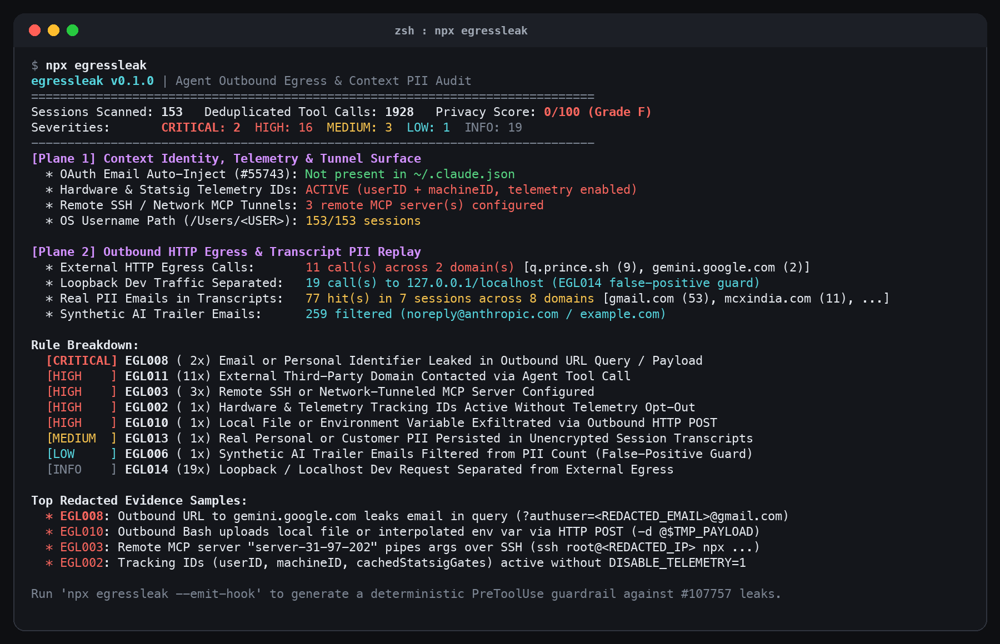

<p align="center">
  
</p>

<h1 align="center">egressleak</h1>

<p align="center">
  Zero-dependency outbound HTTP egress, <code>User-Agent</code> email leak, and context PII auditor for Claude Code, Codex CLI, and MCP configs.
</p>

<p align="center">
  
</p>

## Why I built this

In `anthropics/claude-code#55743` and `#107757`, developers discovered that Claude Code reads `oauthAccount.emailAddress` from `~/.claude.json`, injects it into every session's system prompt as a `# userEmail` block, and then autonomously copies that email into outbound `User-Agent` headers (`curl -A`, Python `requests`) or URL query strings when hitting third-party APIs like SEC EDGAR or Nominatim.

Even after `# userEmail` is patched upstream, coding agents still ingest personal emails, phone numbers, local OS usernames (`/Users/<user>`), and tokens from `~/.gitconfig`, `CLAUDE.md`, `AGENTS.md`, and scraped browser/email outputs. Once those strings enter the context window, any `Bash`, `WebFetch`, `WebSearch`, or remote SSH MCP tool call can transmit them to external domains without a per-request identity check.

`egressleak` audits your local coding agent setup across two planes and can emit a deterministic `PreToolUse` guardrail hook that blocks outbound email or token leaks before execution.

## Quickstart

```bash
npx egressleak
```

Generate a deterministic Claude Code `PreToolUse` guardrail hook and telemetry opt-out config:

```bash
npx egressleak --emit-hook
```

Fail CI or pre-commit checks if `CRITICAL` or `HIGH` leaks are detected:

```bash
npx egressleak --fail-on HIGH
```

## Real audit on 153 local sessions (1,928 deduplicated tool calls)

Running `npx egressleak` across `153` local transcripts (`126` Claude Code sessions in `~/.claude/projects/**/*.jsonl` and `27` Codex CLI sessions in `~/.codex/sessions/**/*.jsonl`, containing `1,928` deduplicated tool calls) surfaced two false-positive traps that naive regex scanners miss, plus real leaks:

1. **Synthetic AI trailer email inflation (`259` synthetic vs `77` real PII hits)**: A raw email regex across the 153 transcripts matched `336` email occurrences. However, `259` of those (`77.1%`) were synthetic `noreply@anthropic.com` and `example.com` strings injected by Claude Code's own `Co-Authored-By` commit trailer instructions. `egressleak` separates synthetic trailer emails (`EGL006`) from real personal/customer PII (`EGL013`), isolating the `77` genuine email occurrences across `8` real domains (`gmail.com` 53, `mcxindia.com` 11, `prince.sh` 4, `adelev8.com` 4, `nvidia.com` 2, `aqr.com` 1).
2. **Loopback dev-server traffic vs external internet egress (`19` loopback vs `11` external)**: Outbound URL extraction across `1,928` tool calls matched `30` HTTP requests. `19` of those (`63.3%`) targeted local dev servers (`127.0.0.1` / `localhost`). `egressleak` isolates loopback traffic (`EGL014`) from the `11` external internet requests (`q.prince.sh` 9, `gemini.google.com` 2).
3. **Caught real leaks**:
   - `2` outbound requests (`EGL008`) passed `?authuser=<REDACTED_EMAIL>@gmail.com` directly in URL query parameters.
   - `1` outbound `curl` POST (`EGL010`) uploaded a local payload file (`-d @$TMP_PAYLOAD`) to an external endpoint.
   - `3` MCP servers in `~/.claude.json` (`EGL003`) piped tool arguments over remote `ssh root@<REDACTED_IP>` tunnels.
   - `userID`, `machineID`, `cachedStatsigGates`, and `cachedGrowthBookFeatures` (`EGL002`) were active in `~/.claude.json` without `DISABLE_TELEMETRY=1` or `CLAUDE_CODE_DISABLE_NONESSENTIAL_TRAFFIC=1`.

## Rules (`EGL001` to `EGL014`)

| Rule | Plane | Severity | What it detects |
| :--- | :--- | :--- | :--- |
| `EGL001` | Identity | `CRITICAL` | `oauthAccount.emailAddress` stored in `~/.claude.json` and auto-injected into session context (`#55743` / `#107757`) |
| `EGL002` | Identity | `HIGH` | Persistent tracking IDs (`userID`, `machineID`, `cachedStatsigGates`, `cachedGrowthBookFeatures`) active without telemetry opt-out |
| `EGL003` | Identity | `HIGH` | Remote SSH (`ssh root@<IP>`) or network-tunneled MCP servers configured in `~/.claude.json` |
| `EGL004` | Identity | `MEDIUM` | Personal/work email hardcoded in `~/.gitconfig`, `~/.claude/CLAUDE.md`, or `~/.agents/AGENTS.md` |
| `EGL005` | Identity | `MEDIUM` | Local OS username path (`/Users/<USER>`) injected across session transcripts |
| `EGL006` | Identity | `LOW` | Synthetic AI trailer emails (`noreply@anthropic.com`, `example.com`) filtered out of PII counts |
| `EGL007` | Egress | `CRITICAL` | Real email or operator identity sent in outbound `User-Agent` header (`curl -A`, `-H "User-Agent: ..."`, `#107757`) |
| `EGL008` | Egress | `CRITICAL` | Email or personal identifier leaked in outbound URL query parameters (`?authuser=`, `?email=`, `?contact=`) |
| `EGL009` | Egress | `CRITICAL` | Bearer token, API key (`sk-`, `ghp_`, `AIza`), or query secret passed in outbound HTTP request |
| `EGL010` | Egress | `HIGH` | Local file (`-d @file`, `--data-binary`) or sensitive env var uploaded via outbound HTTP POST |
| `EGL011` | Egress | `HIGH` | External non-loopback domain contacted via `Bash`, `WebFetch`, or `exec_command` |
| `EGL012` | Egress | `MEDIUM` | Email address, local username path, or secret token leaked inside a `WebSearch` query |
| `EGL013` | Egress | `MEDIUM` | Real personal or customer email domains persisted in plaintext `.jsonl` transcripts |
| `EGL014` | Egress | `INFO` | Loopback HTTP requests (`127.0.0.1`, `localhost`) separated from external internet egress |

## Automatic Redaction

All terminal and JSON output automatically masks sensitive tokens before printing:
- Real emails: `<REDACTED_EMAIL>@gmail.com` (domain preserved for attribution, local inbox masked)
- Public IPv4 addresses: `<REDACTED_IP>` (`127.0.0.1` preserved for loopback verification)
- API keys & Bearer tokens: `<REDACTED_TOKEN>`
- OS home paths: `/Users/<USER>`

## Limitations

- **Static & transcript-level visibility only**: `egressleak` inspects `.jsonl` session transcripts and agent config files on disk. If an agent executes a compiled binary or a Python script whose outbound URL is constructed dynamically at runtime without appearing in the tool call arguments, transcript replay cannot see the destination host unless a network-level proxy (such as `mitmproxy` or PacketFilter/Little Snitch) is used.
- **`PreToolUse` hook scope**: The generated `egress-guard-hook.mjs` inspects `Bash`, `WebFetch`, and `WebSearch` tool inputs in Claude Code. It blocks literal email addresses, `User-Agent` contact strings, and secret tokens in tool arguments, but does not inspect child processes spawned inside an already-approved script file.

## License

MIT
